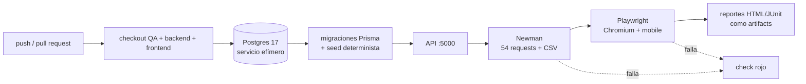

# GiraCanchera — QA

[](https://github.com/wevillegas/giracanchera-qa/actions/workflows/qa.yml)

Pipeline de QA automatizado de [GiraCanchera](https://giracanchera.vercel.app), una red social de estadios de fútbol en producción. Corre **tests de API con Postman/Newman** y **tests E2E con Playwright** en cada push y pull request, contra una base de datos de test efímera, y publica los reportes.

| App | Repo |
|---|---|
| API (Node.js + Express 5 + PostgreSQL/Prisma) | [giracanchera-backend](https://github.com/wevillegas/giracanchera-backend) |
| Web (React 19 + Vite + MapLibre) | [giracanchera-frontend](https://github.com/wevillegas/giracanchera-frontend) |

Este repo no tiene código de la app: hace checkout de los dos repos, los levanta contra una base de test y los prueba como lo haría un cliente externo.

## Pipeline



### Cuándo corre

| Evento | Qué se prueba | Para qué |
|---|---|---|
| Pull request en el **backend** o el **frontend** | La rama del PR + el `main` del otro repo | **Gating**: el check aparece en el PR y frena el merge si algo se rompe, antes de que Render o Vercel desplieguen |
| Push a `main` del backend o del frontend | Ese commit + el `main` del otro repo | Confirmar lo que se desplegó |
| Push o PR en este repo | `main` de ambos repos | Probar cambios en los tests |
| Todos los días, 6:00 (Argentina) | `main` de ambos repos | Detectar lo que se rompe sin que nadie toque código (dependencias, servicios externos) |
| A mano (*Run workflow*) | Las ramas que elijas | Probar cualquier combinación |

El backend y el frontend no copian los tests: cada uno tiene un workflow de pocas líneas que llama a este con `uses: wevillegas/giracanchera-qa/.github/workflows/qa.yml@main` (*reusable workflow*). La lógica vive en un solo lugar.

## Qué cubre

### API — Postman + Newman (`api-tests/`)

| Carpeta | Requests | Qué valida |
|---|---|---|
| 01 Auth | 16 | Login ok/400/401, objeto como email (inyección NoSQL) → 400, mismo mensaje para usuario inexistente y contraseña incorrecta, cookie `HttpOnly` + `SameSite`, token fuera del body, `/me` con/sin/token inválido, registro (débil, email inválido, duplicado, ok con rol `user`), logout invalida el token en el servidor |
| 02 Estadios | 12 | Listado y detalle con esquema JSON, 404 (inexistente y formato inválido), crear sin sesión → 401, como usuario → 403, validaciones → 400, alta y baja como admin |
| 03 Reseñas | 13 | Validaciones (faltan campos, puntaje 11, decimal, estadio inexistente), alta con esquema, aparece en el listado del estadio, like (ok / propio → 400 / inexistente → 404), borrar ajena → 403, borrar propia, borrar dos veces → 404 |
| 04 Usuarios | 9 | Perfil propio y público (sin `email`/`password`/`tokenVersion`), búsqueda, follow inválido, endpoints de admin por rol |
| 05 Varios | 4 | Health, clubes, estadísticas públicas coherentes con el seed, ruta inexistente |
| Data-driven | 7 iteraciones | `data/logins.csv`: email, username, mayúsculas, contraseña de otra cuenta, cuenta inexistente, campos vacíos — cada fila con su `expectedStatus` |

Además, **en todas las requests** (script a nivel colección): status esperado (sale del nombre, `"… → 401"`), sin 5xx, tiempo de respuesta < umbral del entorno (1000 ms local / 2000 ms CI), `Content-Type` JSON, header de seguridad de helmet y errores con `message` legible. En total, **371 aserciones**.

### E2E — Playwright + TypeScript (`e2e/`)

| Spec | Flujo |
|---|---|
| `home.spec.ts` | La home carga y el mapa (MapLibre/WebGL) se renderiza con sus pines · buscar un estadio → el mapa viaja → tocar el pin → ficha completa con sus reseñas · link directo `/estadio/:id` · búsqueda sin resultados |
| `auth.spec.ts` | Login exitoso · login con error visible (el modal sigue abierto) · sin sesión, "Registrar visita" pide iniciar sesión |
| `review.spec.ts` | Con sesión: elegir estadio → completar la reseña → guardar → aparece en la pestaña Reseñas del estadio |
| `mobile.spec.ts` | Pixel 7: el mapa ocupa la pantalla, el login está en el menú hamburguesa, la ficha no tiene scroll horizontal |

Page Objects en `e2e/pages/` (`HomePage`, `LoginModal`, `StadiumPage`, `VisitForm`). Selectores por rol, label y placeholder; un único `data-testid` (el contenedor del mapa, que no tiene rol accesible).

## Correr todo en local

Requisitos: Node ≥ 22.18, Docker, y los repos de la app clonados como carpetas hermanas:

```
gira-canchera/
├─ giracanchera-back/      (npm install)
├─ giracanchera-front/     (npm install)
└─ giracanchera-qa/        ← este repo
```

```bash
npm install
npx playwright install chromium
cp .env.example .env          # completar JWT_SECRET y las 3 contraseñas de prueba

npm run db:test:up            # Postgres de test en :5434 (en memoria)
npm run db:test:reset         # aplica las migraciones del backend

npm run start:api             # en otra terminal: API de test en :5000
npm run test:api              # siembra la base y corre Newman
npm run test:e2e              # siembra la base, levanta el front si hace falta y corre Playwright
```

| Script | Qué hace |
|---|---|
| `db:test:up` / `db:test:down` | Levanta / baja el Postgres de test |
| `db:test:reset` | Migraciones del backend + base vacía |
| `db:test:seed` | Vacía y carga los datos fijos (repetible) |
| `start` · `start:api` · `start:web` | API y/o frontend apuntando a la base de test |
| `test:api` · `test:api:ci` | Newman con el entorno local / ci |
| `test:e2e` · `test:e2e:report` | Playwright / abrir su reporte |
| `typecheck` | `tsc --noEmit` sobre los tests E2E |

Los scripts **se niegan a correr** si `TEST_DATABASE_URL` no apunta a `localhost` y a una base `*_test`, y los tests cortan si la API en `:5000` no es la de test (por ejemplo, si quedó corriendo el backend de desarrollo).

## Reportes

- **Local:** `reports/api.html`, `reports/api-login-csv.html` (htmlextra) y `reports/e2e/` (`npm run test:e2e:report`). En fallos E2E, screenshot y trace en `test-results/` (`npx playwright show-trace <zip>`).
- **Público:** el último reporte de `main` está en **[wevillegas.github.io/giracanchera-qa](https://wevillegas.github.io/giracanchera-qa/)** (GitHub Pages, se publica también cuando los tests fallan). Va sin los traces de Playwright, que graban lo que se tipea; esos quedan solo en el artifact.
- **CI:** cada corrida sube el artifact **`qa-reports`** (HTML + JUnit + traces + log de la API), aunque los tests fallen. Pestaña [Actions](https://github.com/wevillegas/giracanchera-qa/actions) → la corrida → *Artifacts*. Los fallos de Playwright aparecen además como anotaciones en el PR.

## Decisiones técnicas

**Repo de QA separado.** Back y front son repos independientes; las pruebas cruzan los dos. Un repo aparte los orquesta (con `workflow_dispatch` se puede elegir la rama de cada uno) y los prueba como caja negra.

**Datos de test deterministas.** Postgres efímero (`tmpfs` en local, `service` en CI), migraciones reales del backend y un seed con UUID fijos que usa el mismo cliente Prisma que la app: si el esquema cambia, el seed falla en el acto. Cada suite vuelve a sembrar antes de correr, y los datos que crean los tests llevan sufijos únicos, así las suites se pueden repetir sin limpiar a mano.

**Sesión con cookie httpOnly en Postman.** La API no devuelve el JWT en el body: lo pone en `Set-Cookie`. La colección desactiva el cookie jar (`disableCookies`), el test de login extrae el token del header y lo guarda en una variable de colección (`{{anaToken}}`, `{{adminToken}}`…), y las requests protegidas lo mandan como `Bearer`. Cada request declara explícitamente con qué identidad corre: ninguna hereda una sesión por accidente.

**Validación reutilizable.** El status esperado vive en el nombre de la request y lo verifica un único script de colección, junto con las demás reglas comunes. Los esquemas JSON (usuario, sesión, estadio, reseña) son variables de colección y se validan con `pm.response.to.have.jsonSchema`.

**Rate limit sin tocar la app.** Login y registro admiten 20 intentos cada 15 minutos por IP; una corrida de `test:api` hace 18 y la de E2E 4, así que dos corridas seguidas ya chocaban con el límite (429). La API de test confía en un proxy (`TRUST_PROXY=1`, como producción detrás de Render) y cada corrida de Newman y de Playwright manda su propio `X-Forwarded-For`: corridas seguidas no comparten contador.

**Newman en CI.** La colección es la misma que se abre en la app de Postman; Newman la corre sin interfaz, con datos de un CSV, variables desde secrets, reportes HTML/JUnit y exit code ≠ 0 si algo falla.

**Page Object Model.** Los tests describen la intención (`home.openStadiumFromSearch(...)`) y los Page Objects saben cómo hacerlo en la UI. Un cambio de la interfaz se arregla en un solo archivo.

**Contra los tests intermitentes.** Login una sola vez por la UI y sesión reusada con `storageState`; red externa bloqueada (los mosaicos satelitales se responden con un PNG vacío); `prefers-reduced-motion` para que el mapa no anime; aserciones web-first de Playwright que reintentan solas, sin `waitForTimeout`; `retries` solo en CI, donde el reporte marca como *flaky* lo que pasó al reintentar. Verificado con `--repeat-each=3`.

**Secretos.** Nada en el repo: `.env` local (ignorado, ver `.env.example`) y GitHub Secrets en CI. Las contraseñas no están en los entornos de Postman (entran por `--env-var`) ni en el CSV (usa `{{anaPassword}}`), y el reporte HTML oculta datos sensibles.
